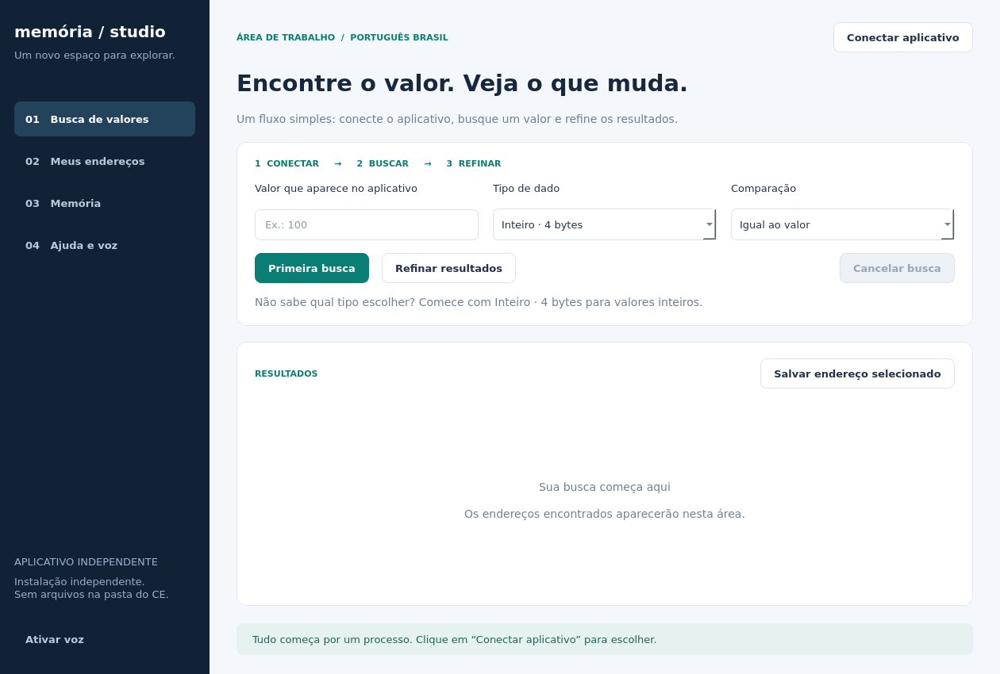

# Memória Studio

Um aplicativo independente para Windows, criado do zero, com interface própria em português do Brasil. Não usa o Cheat Engine e não modifica sua instalação.



## Baixar

- [Código-fonte pronto para iniciar](downloads/MemoriaStudio-Fonte.zip): extraia em uma pasta própria e abra `Iniciar.cmd`. Requer Python 3.12 x64; o iniciador instala as dependências em uma `.venv` dentro da própria pasta.
- O fluxo **Memoria Studio Windows** em [Actions](https://github.com/Leandroxx10/testerea/actions) testa a API nativa e gera o executável. Quando esse fluxo concluir com sucesso, o pacote compilado estará em [Releases](https://github.com/Leandroxx10/testerea/releases). A existência do código não comprova uma compilação bem-sucedida.

```bat
curl.exe --fail -L "https://raw.githubusercontent.com/Leandroxx10/testerea/main/downloads/MemoriaStudio-Fonte.zip" -o "%USERPROFILE%\Downloads\MemoriaStudio-Fonte.zip"
```

A implementação e os limites estão descritos no [guia do aplicativo](standalone/LEIA-ME.md).

## Remover a extensão anterior do Cheat Engine

Feche o Cheat Engine e remova **somente** os arquivos criados pela extensão anterior:

```text
C:\Program Files\Cheat Engine\autorun\ce_modern.lua
C:\Program Files\Cheat Engine\autorun\ce_modern\
```

Não apague a pasta `autorun` nem os demais scripts. Se personalizou os arquivos acima, copie-os antes. Reabra o CE: as mudanças visuais da extensão eram feitas durante a execução. Os instaladores anteriores não substituíam os executáveis do programa. As pastas `CE-Modern-backup-*` preservam versões anteriores da própria extensão; restaurá-las reativaria a extensão.

Os pacotes antigos foram retirados dos downloads. O código histórico está em `legacy/ce-modern`, sem uso pelo novo app.

## Estado da entrega

Busca numérica, refinamento, cancelamento, endereços salvos, edição/congelamento, projetos próprios, leitura hexadecimal, desmontagem x64 e comandos de voz pt-BR foram implementados. A voz depende do microfone e do reconhecedor local do Windows. Não há suporte a `.CT`, depurador, drivers, Auto Assembler ou scripts nesta primeira versão independente.

A interface foi renderizada e inspecionada no Linux. Os testes locais de busca e interface passaram; o teste da API nativa é exclusivo do Windows e roda no fluxo de compilação. Verifique o resultado desse fluxo antes de considerar o executável validado. O microfone precisa ser testado no computador de destino.
